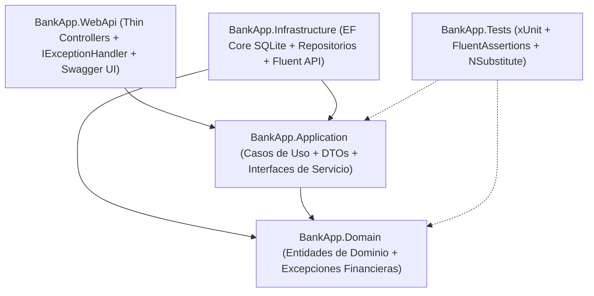

# BankApp - API de Banca Digital (.NET 10)

Solución backend empresarial para banca digital desarrollada por **Gabriel** para el proceso de evaluación técnica de **Sistemática / Grupo LAFISE**. El proyecto implementa una arquitectura desacoplada basada en **Clean Architecture**, principios **SOLID** y diseño guiado por el dominio (**DDD**) pragmático sobre **.NET 10 (C# 13)**.

---

## Tabla de Contenidos
1. [Vision General y Pilares Arquitectonicos](#vision-general-y-pilares-arquitectonicos)
2. [Estructura del Proyecto](#estructura-del-proyecto)
3. [Cumplimiento de Requisitos y Restricciones Tecnicas](#cumplimiento-de-requisitos-y-restricciones-tecnicas)
4. [Requisitos Previos](#requisitos-previos)
5. [Instrucciones de Ejecucion y Despliegue Local](#instrucciones-de-ejecucion-y-despliegue-local)
6. [Documentacion de la API REST](#documentacion-de-la-api-rest)
7. [Suite de Pruebas Unitarias](#suite-de-pruebas-unitarias)
8. [Decisiones de Diseno Bancario](#decisiones-de-diseno-bancario)

---

## Vision General y Pilares Arquitectonicos

El motor de servicios ha sido diseñado bajo estándares de confiabilidad, mantenibilidad y seguridad requeridos en entornos financieros:

- **Aislamiento Estricto de Persistencia:** Controladores delegados (*Thin Controllers*) que operan exclusivamente mediante contratos de interfaces de aplicación y Data Transfer Objects (DTOs), eliminando cualquier acoplamiento con la capa de datos.
- **Manejo Centralizado de Excepciones:** Implementación nativa de `IExceptionHandler` (`GlobalExceptionHandler`) para interceptar fallas de infraestructura y excepciones de dominio personalizadas, traduciéndolas al estándar internacional **RFC 7807 (Problem Details)** sin incurrir en bloques `try-catch` redundantes en la capa de controladores.
- **Trazabilidad e Inmutabilidad Financiera:** Cada movimiento contable (depósito o retiro) genera un registro inmutable que almacena el saldo resultante inmediatamente posterior a la transacción (`ResultingBalance`), garantizando auditoría histórica consistente.
- **Integridad Física de Datos:** Restricción a nivel de esquema físico en base de datos mediante un índice único sobre la columna `AccountNumber` en SQLite.



---

## Estructura del Proyecto

La solución adopta una segmentación modular en proyectos independientes:

```text
BankApp/
├── src/
│   ├── BankApp.Domain/             # Núcleo puro de dominio sin dependencias externas:
│   │                               # Entidades (Customer, Account, Transaction),
│   │                               # Enums, excepciones de negocio y contratos de persistencia.
│   │
│   ├── BankApp.Application/        # Lógica de aplicación y casos de uso:
│   │                               # DTOs inmutables (records), servicios (CustomerService,
│   │                               # AccountService) y algoritmo generador de cuentas bancarias.
│   │
│   ├── BankApp.Infrastructure/     # Persistencia y servicios externos:
│   │                               # Implementación de ApplicationDbContext con EF Core SQLite,
│   │                               # mapeos Fluent API e implementación de repositorios.
│   │
│   └── BankApp.WebApi/             # Punto de entrada HTTP (ASP.NET Core Web API):
│                                   # Controladores REST, middleware IExceptionHandler,
│                                   # configuración de inyección de dependencias y OpenAPI/Swagger.
└── tests/
    └── BankApp.Tests/              # Suite de pruebas automatizadas:
                                    # Pruebas unitarias de casos de uso, lógica financiera y generador.
```

---

## Cumplimiento de Requisitos y Restricciones Tecnicas

| # | Requisito / Restricción de la Prueba | Implementación Técnica en la Solución |
|---|---|---|
| 1 | **Desacoplamiento de Persistencia** | Queda estrictamente prohibida la inyección de `DbContext` en los controladores. `CustomersController` y `AccountsController` interactúan únicamente mediante las interfaces `ICustomerService` y `IAccountService`, manipulando DTOs de entrada y salida. |
| 2 | **Algoritmo de Cuenta `ACC-YYYYMMDD-[XXXX]`** | Implementado en `AccountNumberGenerator`. Garantiza el prefijo constante `ACC-`, la fecha de emisión en formato UTC `YYYYMMDD` y un sufijo de 4 dígitos aleatorios/secuenciales, totalizando una longitud exacta de 17 caracteres. |
| 3 | **Manejo Global de Excepciones** | Implementación de `IExceptionHandler` (`GlobalExceptionHandler`) registrado en el pipeline de ASP.NET Core. Excepciones como `InsufficientFundsException`, `AccountNotFoundException` o `CustomerNotFoundException` se transforman automáticamente en respuestas JSON semánticas (400 Bad Request / 404 Not Found) bajo RFC 7807. Cero bloques `try-catch` en controladores. |
| 4 | **Persistencia e Índice Único** | Base de datos SQLite gestionada mediante Entity Framework Core. En `AccountConfiguration` se define la restricción física `builder.HasIndex(a => a.AccountNumber).IsUnique()` para garantizar unicidad a nivel de motor relacional. |
| 5 | **Transacciones e Historial con Saldo Resultante** | La entidad `Transaction` registra de manera inmutable el identificador de operación, tipo (`Deposit` o `Withdrawal`), importe, marca de tiempo UTC y el `ResultingBalance` post-transacción. |
| 6 | **Pruebas Unitarias Obligatorias** | Proyecto de pruebas en `BankApp.Tests` con cobertura completa para depósitos, retiros con saldo suficiente, rechazo limpio ante saldo insuficiente y validación exhaustiva del formato/unicidad del generador de cuentas. |

---

## Requisitos Previos

- **.NET 10 SDK** (o versión superior instalada en el entorno de desarrollo).
- **Git** para clonación de código y control de versiones.
- **Herramienta de desarrollo compatible:** Visual Studio Code, Visual Studio 2022/2026, o JetBrains Rider.

---

## Instrucciones de Ejecucion y Despliegue Local

### 1. Clonar el repositorio
```bash
git clone <URL_DEL_REPOSITORIO>
cd BankApp
```

### 2. Restaurar dependencias del proyecto
```bash
dotnet restore
```

### 3. Compilar la solucion completa
```bash
dotnet build --configuration Release
```

### 4. Ejecutar la suite de pruebas unitarias
```bash
dotnet test --logger "console;verbosity=detailed"
```

### 5. Iniciar la API Web
```bash
dotnet run --project src/BankApp.WebApi
```

### 6. Acceso a Documentacion Interactiva (Swagger UI)
Una vez levantado el servicio, la documentación interactiva OpenAPI/Swagger se encuentra expuesta en la raíz del host:
- HTTP: `http://localhost:5000`
- HTTPS: `https://localhost:7001`

*Nota sobre la Base de Datos:* La base de datos SQLite local (`bankapp.db`) y sus esquemas relacionales se configuran de forma automática durante la inicialización de la aplicación mediante la rutina de verificación de persistencia en `Program.cs`.

---

## Documentacion de la API REST

### 1. Crear Perfil de Cliente
- **Ruta:** `POST /api/customers`
- **Cabeceras:** `Content-Type: application/json`
- **Cuerpo de Solicitud (Request):**
```json
{
  "fullName": "Gabriel Empresarial",
  "dateOfBirth": "1998-05-15",
  "gender": "Masculino",
  "monthlyIncome": 2500.00
}
```
- **Respuesta Exitosa (201 Created):**
```json
{
  "id": "3fa85f64-5717-4562-b3fc-2c963f66afa6",
  "fullName": "Gabriel Empresarial",
  "dateOfBirth": "1998-05-15",
  "gender": "Masculino",
  "monthlyIncome": 2500.00,
  "createdAt": "2026-10-21T10:00:00Z"
}
```

---

### 2. Apertura de Cuenta Bancaria
- **Ruta:** `POST /api/accounts`
- **Cabeceras:** `Content-Type: application/json`
- **Cuerpo de Solicitud (Request):**
```json
{
  "customerId": "3fa85f64-5717-4562-b3fc-2c963f66afa6",
  "initialDeposit": 1000.00
}
```
- **Respuesta Exitosa (201 Created):**
```json
{
  "id": "a1b2c3d4-e5f6-7a8b-9c0d-1e2f3a4b5c6d",
  "accountNumber": "ACC-20261021-4821",
  "balance": 1000.00,
  "customerId": "3fa85f64-5717-4562-b3fc-2c963f66afa6",
  "createdAt": "2026-10-21T10:01:00Z"
}
```

---

### 3. Consultar Saldo Actual
- **Ruta:** `GET /api/accounts/{accountNumber}/balance`
- **Parametro de Ruta:** `accountNumber` (ej. `ACC-20261021-4821`)
- **Respuesta Exitosa (200 OK):**
```json
{
  "accountNumber": "ACC-20261021-4821",
  "balance": 1000.00,
  "asOfDate": "2026-10-21T10:02:00Z"
}
```

---

### 4. Registrar Deposito
- **Ruta:** `POST /api/accounts/{accountNumber}/deposit`
- **Cuerpo de Solicitud (Request):**
```json
{
  "amount": 500.00
}
```
- **Respuesta Exitosa (200 OK):**
```json
{
  "id": "e9f8a7b6-c5d4-e3f2-a1b0-9c8d7e6f5a4b",
  "type": "Deposit",
  "amount": 500.00,
  "resultingBalance": 1500.00,
  "timestamp": "2026-10-21T10:03:00Z"
}
```

---

### 5. Registrar Retiro de Fondos
- **Ruta:** `POST /api/accounts/{accountNumber}/withdraw`
- **Cuerpo de Solicitud (Request):**
```json
{
  "amount": 300.00
}
```
- **Respuesta Exitosa (200 OK):**
```json
{
  "id": "f1e2d3c4-b5a6-9f8e-7d6c-5b4a3f2e1d0c",
  "type": "Withdrawal",
  "amount": 300.00,
  "resultingBalance": 1200.00,
  "timestamp": "2026-10-21T10:04:00Z"
}
```
- **Respuesta ante Fondos Insuficientes (400 Bad Request - RFC 7807):**
```json
{
  "type": "https://tools.ietf.org/html/rfc7807",
  "title": "Fondos Insuficientes",
  "status": 400,
  "detail": "Fondos insuficientes. Saldo actual: $1,200.00, monto solicitado: $5,000.00.",
  "instance": "/api/accounts/ACC-20261021-4821/withdraw"
}
```

---

### 6. Historial Cronologico de Transacciones
- **Ruta:** `GET /api/accounts/{accountNumber}/history`
- **Respuesta Exitosa (200 OK):**
```json
{
  "accountNumber": "ACC-20261021-4821",
  "currentBalance": 1200.00,
  "transactions": [
    {
      "id": "11111111-1111-1111-1111-111111111111",
      "type": "Deposit",
      "amount": 1000.00,
      "resultingBalance": 1000.00,
      "timestamp": "2026-10-21T10:01:00Z"
    },
    {
      "id": "22222222-2222-2222-2222-222222222222",
      "type": "Deposit",
      "amount": 500.00,
      "resultingBalance": 1500.00,
      "timestamp": "2026-10-21T10:03:00Z"
    },
    {
      "id": "33333333-3333-3333-3333-333333333333",
      "type": "Withdrawal",
      "amount": 300.00,
      "resultingBalance": 1200.00,
      "timestamp": "2026-10-21T10:04:00Z"
    }
  ]
}
```

---

## Suite de Pruebas Unitarias

El proyecto de pruebas `BankApp.Tests` implementa una batería de **11 pruebas automatizadas** diseñadas bajo el patrón AAA (*Arrange, Act, Assert*):

### Pruebas de Algoritmo (`AccountNumberGeneratorTests`)
- Verificación estricta de longitud total de 17 caracteres.
- Validación de prefijo inmutable `ACC-`.
- Comprobación de marca temporal en formato `YYYYMMDD` basada en el proveedor horario UTC.
- Validación de formato regex contra la regla formal `^ACC-\d{8}-\d{4}$`.
- Garantía de entropía y variabilidad en la generación de sufijos aleatorios.

### Pruebas de Logica Financiera (`AccountTests`)
- Depósito regular con incremento aritmético correcto y generación de movimiento en el historial.
- Retiro autorizado con decremento de balance y registro de saldo resultante.
- Lanzamiento de `InsufficientFundsException` ante intentos de retiro que excedan los fondos disponibles.
- Validación de montos no permitidos (valores negativos o en cero) arrojando `ArgumentException`.
- Validación de contratos de integridad al instanciar cuentas con formatos no reconocidos.

---

## Decisiones de Diseno Bancario

1. **Inmutabilidad de Transacciones:** Las operaciones de débito y crédito no permiten modificaciones ni eliminaciones. Una vez asentado el registro contable con su `ResultingBalance`, permanece inalterable para garantizar trazabilidad ante auditorías regulatorias.
2. **Politica de Eliminacion de Registros (Soft Delete vs. Hard Delete):** En conformidad con normativas de auditoría financiera (Basilea, SARLAFT y estándares bancarios locales), se prohíbe el borrado físico (`Hard Delete`) de cuentas y transacciones. La cancelación de cuentas se gestiona mediante inactivación lógica o cambio de estado (`Status = Closed`), supeditada a que el saldo sea estrictamente equivalente a $0.00.
3. **Manejo Estandarizado de Errores:** Se desacopla el control de flujo de la capa de transporte mediante excepciones personalizadas de negocio, evitando que detalles internos de infraestructura o de base de datos se filtren al consumidor de la API.